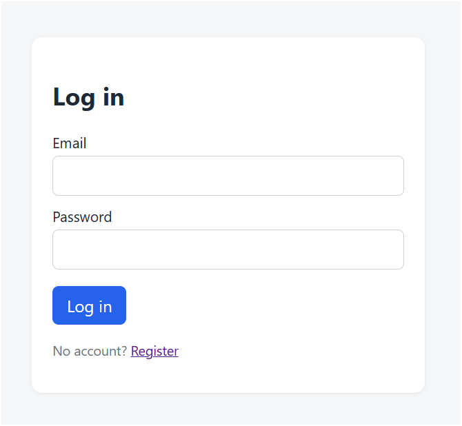
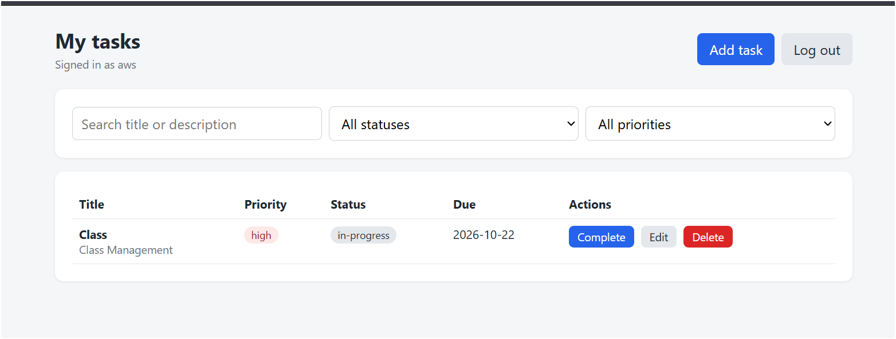
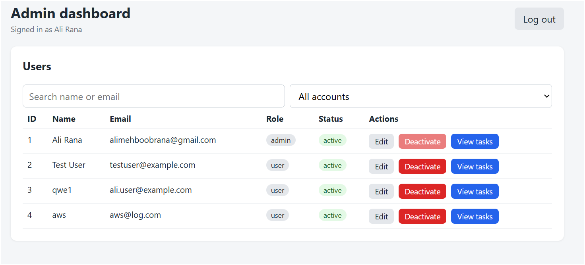

# Role-Based To-Do App

A full-stack task manager with separate User and Admin roles.

## Tech stack
- Backend: FastAPI, SQLAlchemy, PostgreSQL, Pydantic, Alembic
- Frontend: React (Vite), React Router, Axios
- Auth: JWT access tokens, bcrypt password hashing

## Features
- Users register, log in, and manage only their own tasks (title, description, priority, due date, status)
- Admins can view all users and their tasks, edit or delete any task, edit profiles, and activate or deactivate accounts
- Role-based access control enforced on the backend: users get 403 on admin endpoints
- Password hashes are never returned by any endpoint
- Every admin action is recorded in an audit log (who, what, which user, when)
- Pagination, plus search and filters by status and priority

## Setup

### Backend

    cd backend
    python -m venv venv
    venv\Scripts\Activate.ps1
    pip install -r requirements.txt

1. Create a PostgreSQL database named todo_db.
2. Copy .env.example to .env, then fill in your database password and a random secret key.
3. Run migrations: alembic upgrade head
4. Create the first admin: python create_admin.py
5. Start the API: uvicorn app.main:app --reload (docs at http://localhost:8000/docs)

### Frontend

    cd frontend
    npm install
    npm run dev

Open http://localhost:5173.

## Screenshots

### Login

### User dashboard

### Admin dashboard

